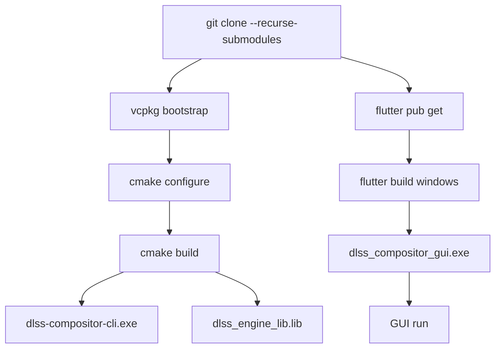

# Build Guide — DLSS Compositor v2

This guide walks through building the DLSS Compositor from source on Windows.
It covers the native C++ engine, the Flutter GUI, and end-to-end verification.
Estimated first-build time: 15-25 minutes (vcpkg compiles dependencies).

---

## 1. Prerequisites

### Required Tools

- **Visual Studio 2022** with:
  - "Desktop development with C++" workload
  - MSVC v143 toolset (selected automatically with the workload)
  - Windows 10/11 SDK (latest, selected via the workload)
  - Download: https://visualstudio.microsoft.com/vs/

- **CMake 3.20+**
  Download from https://cmake.org/download/ and add to PATH during install.
  Verify: `cmake --version`

- **Vulkan SDK 1.3+**
  Download from https://vulkan.lunarg.com/
  The SDK must include `glslc.exe` for shader compilation.
  Verify after install (restart terminal first): `glslc --version`

- **vcpkg**
  C++ package manager, bootstrapped manually (see Section 3).

- **Flutter 3.22+**
  Install via https://docs.flutter.dev/get-started/install/windows
  Verify: `flutter --version`

- **Python 3.11+**
  Required for Blender extension tests.
  Verify: `python --version`

- **Git with LFS**
  Download from https://git-lfs.github.com/
  LFS is needed for large binary assets in the repo.
  Verify: `git lfs version`

### GPU Requirements

- NVIDIA RTX GPU (Turing or newer for Super Resolution; Ada/Blackwell for Frame Generation)
- NVIDIA Driver 535 or newer

Check your driver version:
```powershell
(Get-WmiObject Win32_VideoController | Where-Object { $_.Name -match "NVIDIA" }).DriverVersion
```

---

## 2. Clone the Repository

```powershell
git clone --recurse-submodules https://github.com/your-org/dlss-compositor.git
cd dlss-compositor
git checkout v2/main
```

The `--recurse-submodules` flag clones the DLSS SDK submodule at `DLSS/`.
Without it, the C++ build will fail with "DLSS_SDK_ROOT must be set."

If you already cloned without the flag, initialize submodules now:
```powershell
git submodule update --init --recursive
```

Verify the DLSS SDK is present:
```powershell
Test-Path DLSS/include/nvsdk_ngx_vk.h  # Should output: True
```

Also verify LFS objects are fetched:
```powershell
git lfs pull
```

---

## 3. vcpkg Setup

vcpkg is used in **manifest mode**: all dependencies are declared in `vcpkg.json`
at the repo root. CMake invokes vcpkg automatically during configure, so you
never need to run `vcpkg install` manually.

You do need to bootstrap vcpkg once and set `VCPKG_ROOT`:

```powershell
# Clone vcpkg (if not already installed system-wide)
git clone https://github.com/microsoft/vcpkg.git C:/vcpkg
C:/vcpkg/bootstrap-vcpkg.bat

# Set VCPKG_ROOT permanently for your user account
[System.Environment]::SetEnvironmentVariable("VCPKG_ROOT", "C:/vcpkg", "User")

# Also set it for the current session so CMake can find it immediately
$env:VCPKG_ROOT = "C:/vcpkg"
```

Verify:
```powershell
$env:VCPKG_ROOT
# Should output: C:/vcpkg
```

The first CMake configure will download and compile all dependencies listed in
`vcpkg.json` (Vulkan headers, nlohmann-json, spdlog, etc.). This takes 10-15
minutes. Subsequent configures reuse the cached packages and finish in seconds.

---

## 4. CMake Configure + Build

The project uses `CMakePresets.json`. Two standard presets are provided:
`x64-windows-msvc-release` and `x64-windows-msvc-debug`.

### Release Build (recommended for testing)

```powershell
# Configure
cmake -B build --preset x64-windows-msvc-release -DDLSS_SDK_ROOT=DLSS

# Build all targets
# --parallel uses all available CPU cores
cmake --build build --config Release --parallel
```

Expected output directory: `build/Release/`

Verify the key outputs exist:
```powershell
Test-Path build/Release/dlss-compositor-cli.exe  # Should output: True
Test-Path build/Release/nvngx_dlss.dll           # Should output: True
Test-Path build/Release/nvngx_dlssg.dll          # Should output: True
```

### Debug Build

```powershell
cmake -B build_debug --preset x64-windows-msvc-debug -DDLSS_SDK_ROOT=DLSS
cmake --build build_debug --config Debug --parallel
```

Debug binaries land in `build_debug/Debug/`.

### Build Specific Targets

You don't have to build everything. Common partial builds:

```powershell
# Build only the static engine library (no CLI)
cmake --build build --config Release --target dlss_engine_lib

# Build only the CLI (also builds dlss_engine_lib as a dependency)
cmake --build build --config Release --target dlss-compositor-cli

# List all available targets
cmake --build build --target help
```

### CMake Cache Variables

| Variable | Default | Purpose |
|---|---|---|
| `DLSS_SDK_ROOT` | `DLSS` | Path to DLSS SDK (relative or absolute) |
| `ENABLE_VALIDATION` | `OFF` | Vulkan validation layers (debug only) |

Pass extra variables with `-D`:
```powershell
cmake -B build --preset x64-windows-msvc-release -DDLSS_SDK_ROOT=DLSS
```

---

## 5. CLI Version

After a successful build, print the CLI version:

```powershell
./build/Release/dlss-compositor-cli.exe --version
```

GPU/NGX capabilities are reported by the runtime status logs when the application starts.

---

## 6. Flutter GUI Build

The Flutter GUI lives under `gui/`. It communicates with the C++ engine
through the `dlss-compositor-cli.exe` process via JSON-RPC over stdio.

```powershell
# Move into the GUI project
cd gui

# Fetch Dart/Flutter dependencies
flutter pub get

# Static analysis (must show 0 issues before committing)
flutter analyze

# Build the release desktop app
flutter build windows --release

# Return to repo root
cd ..
```

The release executable is at:
```
gui/build/windows/x64/runner/Release/dlss_compositor_gui.exe
```

It is self-contained. You can copy it alongside the C++ DLLs and CLI to
distribute without installing Flutter on end-user machines.

### Development mode (hot reload)

```powershell
cd gui
flutter run -d windows
```

Flutter hot reload works for UI changes. Changes to the C++ engine require
a rebuild of the native targets.

---

## 7. Run the Application

### GUI (release)

```powershell
./gui/build/windows/x64/runner/Release/dlss_compositor_gui.exe
```

The GUI automatically discovers `dlss-compositor-cli.exe` relative to its own
location. If you move the GUI executable, copy the `Release/` folder contents
together so the relative path stays intact.

### CLI (process a config file)

```powershell
./build/Release/dlss-compositor-cli.exe `
  --config path/to/dlssconfig.json `
  --output-dir out/
```

### CLI (interactive JSON-RPC session)

```powershell
./build/Release/dlss-compositor-cli.exe --rpc-stdio
# Type or pipe JSON-RPC messages, one per line
```

---

## 8. VSCode F5 Debugging

The repo ships a pre-configured VSCode launch setup. See
[Debug Setup](debug_setup.md) for the full compound Flutter + C++ dual-debug
configuration.

Quick start:

1. Open the repo root folder in VSCode (`File > Open Folder`).
2. Install the recommended extensions when prompted, or install manually:
   - **Dart-Code** (`dart-code.dart-code`) — Flutter/Dart debugger
   - **C/C++** (`ms-vscode.cpptools`) — native debugger
   - **CMake Tools** (`ms-vscode.cmake-tools`) — CMake integration
3. Press `F5` and select **"Flutter + C++ (Plugin Debug)"** from the dropdown.

This compound config starts both the Flutter app and the C++ engine process,
attaching breakpoints to each. You can set breakpoints in `.dart` files and
`.cpp` files simultaneously.

---

## 9. Troubleshooting

### "DLSS_SDK_ROOT must be set" or missing header errors

The DLSS SDK submodule wasn't initialized. Run:
```powershell
git submodule update --init --recursive
Test-Path DLSS/include/nvsdk_ngx_vk.h  # Must be True
```

### "VCPKG_ROOT not found" during cmake configure

The environment variable isn't visible to the current shell. Set it:
```powershell
$env:VCPKG_ROOT = "C:/vcpkg"  # Current session
# For all future sessions, set it via Windows Settings > Environment Variables
```

Then re-run the cmake configure step.

### "vulkan.h not found" or glslc errors

Vulkan SDK isn't installed or isn't on PATH. Steps:
1. Download and install from https://vulkan.lunarg.com/
2. Close and reopen your terminal (the installer modifies PATH)
3. Verify: `glslc --version`
4. Re-run cmake configure

### Build error: "LNK1104: cannot open file nvngx_dlss.lib"

The DLSS SDK lib files are tracked via Git LFS. Pull them:
```powershell
git lfs pull
```

### NGX Init Failed / SR Unavailable

- Update NVIDIA drivers to 535 or newer (GeForce Experience or manual from https://www.nvidia.com/drivers)
- Confirm an RTX GPU is installed: `Get-WmiObject Win32_VideoController | Select-Object Name`
- Inspect the application's NGX initialization and capability logs.

### `flutter pub get` fails / Flutter not found

Ensure Flutter 3.22+ is installed and on PATH:
```powershell
flutter --version
flutter doctor  # Shows missing dependencies
```

If `flutter` isn't recognized, add the Flutter `bin/` directory to your
user PATH in Windows Settings > Environment Variables.

### First build takes too long

vcpkg downloads and compiles all C++ dependencies on the first configure.
This is normal and takes 10-15 minutes depending on your machine.
After the first build, vcpkg caches everything at `C:/vcpkg/installed/`.
Subsequent configures and builds take under 2 minutes.

### CMake can't find the MSVC compiler

Run the CMake configure command inside a **Visual Studio Developer PowerShell**
or **x64 Native Tools Command Prompt** (found in the Start menu under Visual
Studio 2022). These shells set up the MSVC environment variables automatically.

Alternatively, install the **CMake Tools** VSCode extension, which handles
the MSVC toolchain detection for you.

---

## Build Flow Diagram


